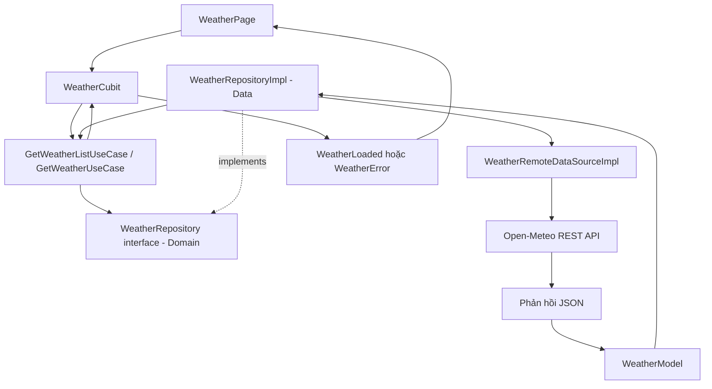

# Clean Architecture Demo — Thời tiết Việt Nam

Ứng dụng Flutter minh họa cách tổ chức mã nguồn theo **Clean Architecture 3 lớp: Presentation, Domain và Data**. Ứng dụng lấy dữ liệu thời tiết hiện tại từ Open-Meteo REST API và hiển thị thông tin của 8 thành phố tại Việt Nam.

## Tính năng

- Lấy dữ liệu thời tiết hiện tại từ Open-Meteo REST API.
- Hiển thị nhiệt độ, tốc độ gió, mô tả thời tiết và biểu tượng tương ứng.
- Hiển thị trạng thái đang tải, thành công hoặc lỗi.
- Cho phép tải lại dữ liệu và thử lại khi có lỗi.
- Tách phần giao diện, nghiệp vụ và truy xuất dữ liệu theo Clean Architecture.
- Quản lý trạng thái với Cubit (`flutter_bloc`) và liên kết dependency bằng GetIt.
- Có unit test cho `GetWeatherUseCase`, sử dụng Mocktail để giả lập Repository.

## Công nghệ sử dụng

- **Flutter / Dart** — xây dựng ứng dụng đa nền tảng.
- **flutter_bloc (Cubit)** — quản lý trạng thái giao diện.
- **get_it** — đăng ký và tra cứu các đối tượng phụ thuộc.
- **http** — gửi yêu cầu HTTP đến REST API.
- **equatable** — hỗ trợ so sánh đối tượng theo giá trị.
- **mocktail** — tạo mock cho unit test.

## Kiến trúc tổng thể



### Vai trò của ba lớp

| Lớp | Trách nhiệm | Thành phần trong dự án |
|---|---|---|
| **Presentation** | Hiển thị giao diện và quản lý trạng thái | `WeatherPage`, `WeatherCubit`, `WeatherState` |
| **Domain** | Định nghĩa Entity, hợp đồng Repository và Use Case | `Weather`, `WeatherRepository`, `GetWeatherUseCase`, `GetWeatherListUseCase` |
| **Data** | Gọi API, phân tích JSON, chuyển đổi dữ liệu và triển khai Repository | `WeatherRemoteDataSourceImpl`, `WeatherModel`, `WeatherRepositoryImpl` |

### Luồng hoạt động

1. `main.dart` khởi tạo Flutter binding và gọi `initDependencies()` để đăng ký các đối tượng với GetIt.
2. `MultiBlocProvider` cung cấp `WeatherCubit` cho widget tree và gọi `fetchWeather()` khi khởi tạo Cubit.
3. `WeatherCubit` phát trạng thái `WeatherLoading`, sau đó gọi `GetWeatherListUseCase`.
4. Use Case gọi `WeatherRepository` — interface được định nghĩa trong Domain.
5. `WeatherRepositoryImpl` triển khai interface đó và gọi `WeatherRemoteDataSourceImpl`.
6. DataSource gửi HTTP GET đến Open-Meteo, đọc JSON và tạo `WeatherModel`.
7. Repository trả kết quả `List<Weather>` về Use Case và Cubit.
8. Cubit phát `WeatherLoaded` nếu thành công hoặc `WeatherError` nếu xảy ra lỗi; `WeatherPage` cập nhật giao diện theo trạng thái.

**Lưu ý về hướng phụ thuộc:** `WeatherRepositoryImpl` ở Data triển khai `WeatherRepository` do Domain định nghĩa. Domain hoàn toàn độc lập và không phụ thuộc trực tiếp vào lớp triển khai của Data.

## Cấu trúc thư mục

```text
lib/
├── core/
│   ├── di/
│   │   └── injection_container.dart          # Đăng ký dependency bằng GetIt
│   └── errors/
│       ├── exceptions.dart                   # Exception kỹ thuật ở Data Layer
│       └── failures.dart                     # Các loại Failure truyền lên tầng Domain
├── features/
│   └── weather/
│       ├── presentation/
│       │   ├── cubit/
│       │   │   ├── weather_cubit.dart        # Điều phối tải dữ liệu, phát State
│       │   │   └── weather_state.dart        # Initial, Loading, Loaded, Error
│       │   └── pages/
│       │       └── weather_page.dart         # Giao diện thời tiết
│       ├── domain/
│       │   ├── entities/
│       │   │   └── weather.dart              # Entity thời tiết
│       │   ├── repositories/
│       │   │   └── weather_repository.dart   # Repository interface
│       │   └── usecases/
│       │       └── get_weather_usecase.dart  # Use Case thời tiết
│       └── data/
│           ├── datasources/
│           │   └── weather_remote_datasource.dart # Gọi Open-Meteo API
│           ├── models/
│           │   └── weather_model.dart         # Đọc dữ liệu JSON thời tiết
│           └── repositories/
│               └── weather_repository_impl.dart   # Triển khai Repository
└── main.dart                                  # Điểm khởi chạy ứng dụng

test/
└── features/weather/domain/
    └── get_weather_usecase_test.dart         # Unit test cho GetWeatherUseCase
```

## API thời tiết

- **Dịch vụ:** [Open-Meteo](https://open-meteo.com/)
- **Endpoint:** `https://api.open-meteo.com/v1/forecast`
- **Phương thức:** `GET`
- **Tham số chính:** `latitude`, `longitude`, `current_weather=true`
- **API key:** Không cần (miễn phí).

Ứng dụng lấy dữ liệu cho 8 thành phố: Hà Nội, TP. Hồ Chí Minh, Đà Nẵng, Hải Phòng, Nha Trang, Cần Thơ, Đà Lạt và Huế.

## Cài đặt và chạy

Mở terminal tại thư mục dự án `clean_arch_demo`, sau đó chạy:

```bash
flutter pub get
```

Chạy trên Chrome:
```bash
flutter run -d chrome
```

Chạy trên Windows Desktop:
```bash
flutter run -d windows
```

Chạy trên Android Emulator hoặc thiết bị thật:
```bash
flutter run
```

## Chạy unit test

```bash
flutter test
```

Unit test kiểm tra 3 tình huống của `GetWeatherUseCase` sử dụng Mocktail:
1. Khi Repository trả về dữ liệu thời tiết thành công.
2. Khi Repository ném `ServerFailure`.
3. Khi truyền tên thành phố không tồn tại (ném `NotFoundFailure`).

## Dependency Injection với GetIt

Các dependency được cấu hình trong `lib/core/di/injection_container.dart`:
- `WeatherCubit` được đăng ký bằng `registerFactory`.
- `GetWeatherListUseCase`, `GetWeatherUseCase`, `WeatherRepository`, `WeatherRemoteDataSource` và `http.Client` được đăng ký theo dạng lazy singleton.
- `main.dart` gọi `initDependencies()` trước `runApp()`.
